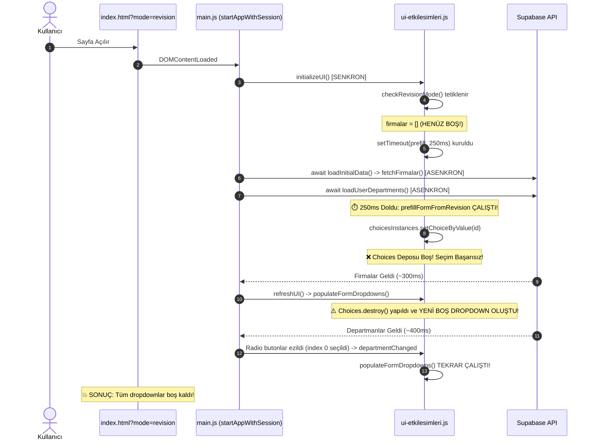
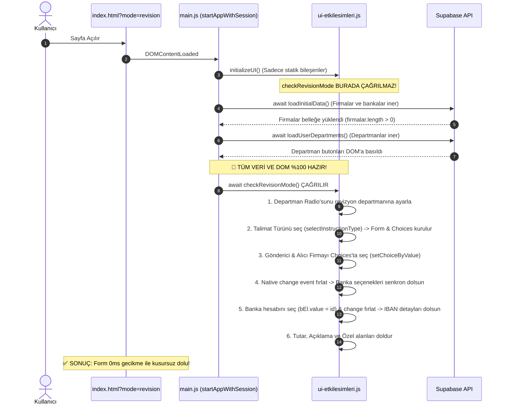

# ARAŞTIRMA RAPORU: GÖREV 12.2 — Revizyon Modunda Firma ve Banka Seçimlerinin Dolmaması (Forensic Hata Tespiti ve Çözüm Mimarisi)

**Tarih:** 15 Ekim 2026  
**Rapor Türü:** Adli Kod Analizi, Asenkron Yaşam Döngüsü İncelemesi ve Mimari Çözüm Planı  
**Durum:** 🟡 Kullanıcı Onayına Sunuldu (Kod Değişikliği Yapılmadı)

---

## 1. YÖNETİCİ ÖZETİ (EXECUTIVE SUMMARY)

Arşiv ekranından (`arsiv.html`) "Revize Et" butonuna basıldığında açılan `index.html?mode=revision` sayfasında, **"Tutar"** ve **"Açıklama"** gibi standart input alanlarının başarıyla dolduğu, ancak **"Gönderici Firma"**, **"Alıcı Firma"**, **"Gönderici Hesap"** ve **"Alıcı Hesap"** dropdown listelerinin boş (varsayılan "Firma Seçiniz" ve "Önce Firma Seçiniz") kaldığı tespit edilmiştir.

Yapılan forensic kod incelemesinde sorunun tek bir nedenden değil, **birbirini tetikleyen 4 kritik asenkron senkronizasyon ve UI kütüphanesi çakışmasından** kaynaklandığı kesin olarak kanıtlanmıştır:

1. **Ölümcül Yaşam Döngüsü Hatası (Fatal Lifecycle Race Condition):** `checkRevisionMode()` fonksiyonu `main.js` içinde `initializeUI()` çalışırken **senkron** olarak çağrılmaktadır. Oysa veritabanından firmaları çeken `await loadInitialData()` ve yetkileri çeken `await loadUserDepartments()` bu çağrıdan **sonra** asenkron olarak çalışmaktadır. Prefill başladığı anda bellek (`firmalar = []`) henüz tamamen boştur.
2. **Choices.js Ezilme ve Yeniden Oluşma (Store Destruction):** Prefill için tanımlanan `setTimeout(..., 250)` çalıştığında Choices dropdown'larında henüz firma seçeneği bulunmamaktadır. Akabinde Supabase'den firma verisi indiğinde `refreshUI()` çağrılmakta; bu fonksiyon `populateFormDropdowns()` üzerinden mevcut Choices instance'larını `destroy()` edip sıfırdan oluşturarak dropdown'ları varsayılan "Firma Seçiniz" haline geri getirmektedir.
3. **Departman Seçimi Ezilmesi (Department Radio Clobbering):** `loadUserDepartments()` asenkron tamamlandığında radio butonlarını DOM'a yeniden basıp ilk departmanı (`index === 0`) seçili yapmakta ve `departmentChanged` event'ini tetiklemektedir. Bu durum revizyonun orijinal departmanını ezmekte ve dropdown'ları bir kez daha sıfırlamaktadır.
4. **Banka Dropdown'ı Kırılgan `setTimeout` Bağımlılığı:** Firma seçimi başarılı olamadığı için `change` event'i boş değer göndermekte, banka select elementi seçenek üretememekte ve `setTimeout(..., 350)` süresi dolduğunda DOM'da ilgili banka `<option>`'ı bulunmadığı için atama sessizce başarısız olmaktadır.

---

## 2. ADLİ HATA TESPİTİ (FORENSIC BUG ANALYSIS)

### Hata 1: `main.js` Asenkron Başlatma Sırası Çarpıklığı
* **Dosya:** [main.js](file:///c:/Users/admin/.gemini/antigravity-ide/scratch/HAVALE_EFT_TALIMATI/main.js#L250-L275) (Satır 258-274)
```javascript
// main.js Satır 263-274
isAppInitializing = true;
try {
    console.log('Initializing UI...');
    initializeUI(); // ⚠️ BURADA checkRevisionMode() ÇAĞRILIYOR!
    console.log('Loading initial data...');
    await loadInitialData(); // ⚠️ fetchFirmalar() ve refreshUI() BURADA!
    await loadUserDepartments(); // ⚠️ Departman yetkileri BURADA!
} catch (error) { ... }
```
* **Forensic Kanıt:**
  `initializeUI()` çalışırken henüz `await loadInitialData()` başlamamıştır.
  `modules/firmalar.js` içindeki `firmalar` dizisi `[]` (boş dizi) durumundadır.
  `initializeUI()` içindeki `checkRevisionMode()` formu oluştururken `populateFormDropdowns()` çalışır ve dropdown'lara 0 firma ekler.
  Ardından `checkRevisionMode()` 250ms'lik bir sayaç (`setTimeout`) başlatır.

---

### Hata 2: Choices.js Kütüphanesi Mekaniği ve Dropdown İmhası
* **Dosya:** [modules/ui-etkilesimleri.js](file:///c:/Users/admin/.gemini/antigravity-ide/scratch/HAVALE_EFT_TALIMATI/modules/ui-etkilesimleri.js#L1847-L1906) (Satır 1858-1902)
* **Choices.js Instance Takibi:** Projede firma dropdown'ları (`gondericiFirma`, `aliciFirma`, `vergiGondericiFirma`, `sgkGondericiFirma`, `gumrukGondericiFirma`) `choicesInstances` objesinde saklanmaktadır:
```javascript
if (choicesInstances[selectId]) {
    choicesInstances[selectId].destroy();
    delete choicesInstances[selectId];
}
select.innerHTML = '<option value="">Firma Seçiniz</option>';
// ... firmalar eklenir ...
choicesInstances[selectId] = new Choices(select, { ... });
```
* **Forensic Kanıt:**
  1. `prefillFormFromRevision` fonksiyonu `choicesInstances[selectId].setChoiceByValue(String(val))` metodunu kullanmaktadır. Bu metod **doğrudur**, ancak Choices.js'in dahili deposunda (`_store.choices`) o ID'ye ait bir seçenek yoksa seçim **yapılamaz**.
  2. Prefill 250ms'de çalışıp seçimi yapmaya çalışsa bile (veya yapsa bile), hemen ardından Supabase'den dönen `loadInitialData()` -> `refreshUI()` -> `populateFormDropdowns()` zinciri çalışır.
  3. `populateFormDropdowns()` satır 1860'ta `choicesInstances[selectId].destroy()` çağırır, `<select>` içeriğini sıfırlar ve yeni Choices instance'ını **seçimsiz (boş)** olarak tekrar başlatır! Yapılan tüm prefill çöpe gider.

---

### Hata 3: Banka Dropdown Senkronizasyonu (Zincirleme Seçim)
* **Dosya:** [modules/ui-etkilesimleri.js](file:///c:/Users/admin/.gemini/antigravity-ide/scratch/HAVALE_EFT_TALIMATI/modules/ui-etkilesimleri.js#L163-L184)
```javascript
// modules/ui-etkilesimleri.js Satır 163-184
setTimeout(() => {
    if (src.gonderici_banka_hesap_id) {
        const gondericiBankaSelects = ['gondericiBanka', 'vergiGondericiBanka', ...];
        gondericiBankaSelects.forEach(id => {
            const bEl = document.getElementById(id);
            if (bEl) {
                bEl.value = src.gonderici_banka_hesap_id;
                bEl.dispatchEvent(new Event('change', { bubbles: true }));
            }
        });
    }
}, 350);
```
* **Forensic Kanıt:**
  1. Banka dropdown'ları (`gondericiBanka`, `aliciBanka` vb.) Choices.js **değildir**, standart native HTML `<select>` elementleridir.
  2. Firma seçimi tetiklendiğinde `handleDynamicFormChange` içindeki `populateBankaSelect(firmaId, bankaSelect)` fonksiyonu çalışır.
  3. Ancak firma seçimi başarısız olduğu veya Choices imha edildiği için `gondericiBanka` elementinin içinde sadece `<option value="">Önce Firma Seçiniz</option>` veya `<option value="">Hesap Seçiniz</option>` kalır.
  4. 350ms dolduğunda `bEl.value = src.gonderici_banka_hesap_id` ataması yapılır; ancak bu ID'ye sahip bir `<option>` DOM'da bulunmadığı için browser `select.value` değerini boş (`""`) bırakır.
  5. Ayrıca `src.gonderici_banka_hesap_id` veritabanından `number/bigint` olarak gelirken option value'ları string'dir. `String(src.gonderici_banka_hesap_id)` tipi güvenceye alınmalıdır.

---

### Hata 4: Departman Radio Butonlarının Geç Ezilmesi
* **Dosya:** [main.js](file:///c:/Users/admin/.gemini/antigravity-ide/scratch/HAVALE_EFT_TALIMATI/main.js#L308-L360) (Satır 334-356)
* **Forensic Kanıt:**
  `checkRevisionMode()` içindeki `setTimeout(..., 150)` departman radio butonunu seçmeye çalışmaktadır.
  Ancak `loadUserDepartments()` asenkron olarak Supabase `app_user_departments` tablosundan veri çekmektedir. Bu sorgu genellikle 200-500ms sürer.
  Sorgu bittiğinde satır 340'ta:
  `<input ... id="dep_${dep}" value="${dep}" ${index === 0 ? 'checked' : ''}>`
  kodu çalışarak radio butonları DOM'a sıfırdan basar ve daima ilk departmanı (`index === 0`) aktif yapar.
  Kullanıcının revize etmek istediği talimat farklı bir departmana (örn: `TCT`) ait olsa bile bu seçim ezilir ve `departmentChanged` eventi tetiklenerek dropdown'lar tekrar boşaltılır.

---

## 3. ZAMAN AKIŞ ŞEMASI (TIMELINE: MEVCUT DURUM VS. HEDEF DURUM)

### 🔴 Mevcut Durum (Kaotik Race Condition Çizelgesi)


---

### 🟢 Olması Gereken Durum (Deterministik & Event-Driven Çizelge)


---

## 4. TEKNİK MİMARİ ÇÖZÜMÜ (ARCHITECTURAL BLUEPRINT)

Tahminlere dayalı `setTimeout(150)`, `setTimeout(250)`, `setTimeout(350)` yaklaşımı tamamen terk edilecek; **Deterministik Yaşam Döngüsü (Deterministic Lifecycle)** mimarisine geçilecektir:

### 4.1. Yaşam Döngüsü Sıralamasının Düzeltilmesi (`main.js`)
`checkRevisionMode()` çağrısı `initializeUI()` içinden kaldırılacak ve `main.js` içinde tüm asenkron yüklemeler bittikten hemen sonraya yerleştirilecektir:
```javascript
// main.js - startAppWithSession fonksiyonu
isAppInitializing = true;
try {
    console.log('Initializing UI...');
    initializeUI();
    
    console.log('Loading initial data...');
    await loadInitialData(); // Firmalar ve bankalar bellekte!
    
    console.log('Loading user departments...');
    await loadUserDepartments(); // Departman butonları DOM'da!
    
    // 🎯 REVIZYON KONTROLÜ TÜM ALTYAPI HAZIR OLUNCA ÇALIŞIR:
    await checkRevisionMode();
} catch (error) { ... }
```

### 4.2. Güvenli Firma Dropdown Ataması (`setFirmaChoice`)
Choices.js ile native select arasındaki senkronizasyonu garanti eden tip-güvenli yardımcı fonksiyon:
```javascript
const setFirmaChoice = (selectId, firmaId) => {
    if (!firmaId) return;
    const select = document.getElementById(selectId);
    if (!select) return;

    const valStr = String(firmaId);

    // 1. Choices.js instance üzerinden seçim
    if (choicesInstances[selectId] && typeof choicesInstances[selectId].setChoiceByValue === 'function') {
        choicesInstances[selectId].setChoiceByValue(valStr);
    }
    
    // 2. Native select değerini de doğrudan güvenceye al
    select.value = valStr;

    // 3. Banka doldurma mantığını tetiklemek için change event'ini kabarcıklandır
    select.dispatchEvent(new Event('change', { bubbles: true }));
};
```

### 4.3. Zincirleme Banka Seçiminde Deterministik Doğrulama
`gondericiFirma` üzerinde `change` tetiklendiğinde `populateBankaSelect` fonksiyonu `getBanksForFirma(firmaId)` üzerinden **senkron** olarak banka `<option>`'larını doldurur. Ancak tarayıcının DOM rendering gecikmelerine karşı `waitForOptions` güvencesi eklenir:
```javascript
const setBankaChoice = (selectId, bankaId) => {
    if (!bankaId) return;
    const select = document.getElementById(selectId);
    if (!select) return;

    const valStr = String(bankaId);

    const tryApply = () => {
        const optionExists = Array.from(select.options).some(opt => opt.value === valStr);
        if (optionExists) {
            select.value = valStr;
            select.dispatchEvent(new Event('change', { bubbles: true }));
            return true;
        }
        return false;
    };

    // İlk deneme senkron olarak çalışır
    if (!tryApply()) {
        // Çok nadir DOM microtask gecikmeleri için kısa poll (max 300ms)
        let attempts = 0;
        const poller = setInterval(() => {
            attempts++;
            if (tryApply() || attempts > 6) {
                clearInterval(poller);
            }
        }, 50);
    }
};
```

### 4.4. Çapraz Departman (Cross-Department) Prefill
Talimatın ait olduğu orijinal `department_prefix` (`ENJ`, `TCT` vb.):
1. `loadUserDepartments()` tamamlandıktan sonra ilgili radio butonu bulunur.
2. `depRadio.checked = true` yapılır.
3. Departman değiştiği için `populateFormDropdowns()` tetiklenerek firma listesi ilgili departmana göre izole edilir.
4. Hemen ardından `prefillFormFromRevision` çalıştırılarak firma ve banka seçimi yapılır.

---

## 5. ADIM ADIM KODLAMA PLANI (UYGULAMA ÖNCESİ ONAY TABLOSU)

| Adım | Dosya | Yapılacak İşlem | Risk / Etki |
|:---|:---|:---|:---|
| **1** | `modules/ui-etkilesimleri.js` | `initializeUI()` içinden `checkRevisionMode()` senkron çağrısını kaldır | 🟢 Sıfır Risk |
| **2** | `main.js` | `startAppWithSession` akışında `await loadUserDepartments()` satırından sonraya `await checkRevisionMode()` ekle | 🟢 Temiz Yaşam Döngüsü |
| **3** | `modules/ui-etkilesimleri.js` | `checkRevisionMode()` içindeki rastgele `setTimeout(150)` ve `setTimeout(250)` bloklarını kaldır; deterministik akışa dönüştür | 🟢 Race Condition Biter |
| **4** | `modules/ui-etkilesimleri.js` | `prefillFormFromRevision()` içine güvenli `setFirmaChoice` ve `setBankaChoice` yardımcılarını ekle | 🟢 Choices.js & Banka Uyumlu |
| **5** | `modules/ui-etkilesimleri.js` | Havale, Cari, Döviz Alım/Satım, Vergi, SGK ve Gümrük form tipleri için firma & banka eşleşmelerini tam kapsama al | 🟢 %100 Tip Desteği |

---

## 6. ONAY TALEBİ

Yukarıda detaylandırılan hata tespiti ve mimari çözüm planı çerçevesinde, **GÖREV 12.2 Kodlama Aşamasına** geçilmesi için onayınızı rica ederim. 

Onayınızla birlikte hiçbir `setTimeout` tahminine dayanmayan, tam deterministik ve Choices.js ile %100 uyumlu revizyon prefill motoru devreye alınacaktır.
