# GÖREV 14.1 — DOKÜMANTASYON MİMARİSİ: KULLANICI KILAVUZU (USER MANUAL) TASLAĞI VE PLANI

**Tarih:** 16 Ekim 2026  
**Durum:** 🟡 ARAŞTIRMA VE TASLAK TAMAMLANDI — KULLANICI ONAYI BEKLENİYOR  
**Hedef Kitle:** Can Holding Finans Departmanı, Muhasebe Uzmanları, Şirket Yöneticileri  
**Çıktı Belgesi:** `ARASTIRMA_GOREV14_1_KILAVUZ_PLANI.md`

---

## 1. GİRİŞ VE DOKÜMANTASYONUN AMACI

Can Holding bünyesinde geliştirilen **Havale/EFT ve Finansal Talimat Yönetim Sistemi**, şirketler arası virman işlemlerinden vergi, SGK, gümrük, döviz ve cari ödemelere kadar tüm bankacılık talimat akışlarını tek bir merkezde toplamaktadır.

Sistemin kodlama, akıllı revizyon, çapraz departman izolasyonu ve arşivleme süreçleri tamamlanmıştır. Bu dokümantasyon planı, sistemi günlük iş akışlarında kullanacak olan **Finans ve Muhasebe personelinin** hiçbir teknik bilgiye ihtiyaç duymadan sistemi hatasız, hızlı ve kurum standartlarına uygun şekilde kullanmasını sağlayacak **Kullanıcı Kılavuzu'nun (User Manual)** mimari planını sunar.

> [!IMPORTANT]
> Bu aşamada kılavuzun nihai metni yazılmamış; kılavuzun **hedef kitle dili**, **kapsamlı içindekiler ağacı**, **modül haritası** ve **sunum formatı önerisi** planlanmıştır.

---

## 2. HEDEF KİTLE VE EDİTÖRYAL DİL STRATEJİSİ

### 2.1. Kullanıcı Profili
* **Kullanıcı Grubu:** Finans yöneticileri, nakit akış uzmanları, muhasebe sorumluları.
* **Teknik Seviye:** Standart web tarayıcısı ve Excel kullanıcıları (yazılım/kod bilgisi bulunmamaktadır).
* **Temel Motivasyon:** Hızlı, hatasız, denetlenebilir ve banka formatına uygun talimat üretmek, mükerrer ödemeleri önlemek ve talimatları güvenle arşivlemek.

### 2.2. Dil ve Anlatım İlkeleri
1. **Sade, Eyleme Yönelik ve Kurumsal Türkçe:** Cümleler edilgen yerine doğrudan eylemi tarif eden emir/yönlendirme kipine sahip olacaktır (*"Giriş yapınız", "Firma seçiniz", "Onay butonuna basınız"*).
2. **Jargondan Arındırılmış Sözlük:** Yazılımsal terimler yerine finans ve arayüz terimleri kullanılacaktır:

| Yazılımsal Terim | Kılavuzdaki Karşılığı |
|:---|:---|
| *Database / Supabase* | Merkezi Finans Sistemi / Sistem Veritabanı |
| *Dropdown / Choices.js* | Açılır Firma / Banka Listesi |
| *DOM / Modal* | İşlem Penceresi / Açılır Form |
| *Soft Delete* | Talimat İptali (Denetim İzi Korumalı) |
| *Prefill / Race Condition* | Akıllı Ön-Doldurma / Otomatik Form Aktarımı |
| *Department Prefix* | Talimat Bölümü (ENJ: Enerji, TCT: Tectone) |
| *Hard Delete* | Kalıcı Silme |

3. **Görsel Bilgi Kutuları (Callouts):**
   * ℹ️ **BİLGİ:** Standart ipuçları ve pratik kullanım önerileri.
   * ⚠️ **DİKKAT:** Hatalı işlem riskini azaltacak uyarılar (Örn: "Döviz işleminde alış/satış yönünü kontrol ediniz").
   * ⛔ **KRİTİK KURAL:** Finansal güvenlik ve mevzuat kuralları (Örn: "Gönderici firma sadece bağlı olduğunuz bölümden seçilebilir").

---

## 3. MODÜL VE YETENEK MATRİSİ (SİSTEM HARİTASI)

Kılavuzda anlatılacak ana ekranlar ve fonksiyonel yetenekler:

```mermaid
graph TD
    A["Can Holding Talimat Sistemi"] --> B["1. Giriş & Departman"]
    A --> C["2. Firma & Banka Yönetimi"]
    A --> D["3. Talimat Formları"]
    A --> E["4. Arşiv & Akıllı Revizyon"]

    B --> B1["Kullanıcı Girişi"]
    B --> B2["Bölüm Seçimi (ENJ / TCT)"]

    C --> C1["Firma Tanımlama"]
    C --> C2["Banka Hesabı Ekleme (IBAN/SWIFT)"]
    C --> C3["Excel ile Toplu Yükleme"]
    C --> C4["Toplu Silme Koruması"]

    D --> D1["Havale/EFT (İç Virman & Dış Transfer)"]
    D --> D2["Vergi Ödemeleri (7 Vergi Türü)"]
    D --> D3["SGK Ödemeleri"]
    D --> D4["Gümrük & Harç Ödemeleri"]
    D --> D5["Cari Hesap (Satıcı & Müşteri)"]
    D --> D6["Döviz Alım/Satım"]

    E --> E1["Kart & Liste Görünümü"]
    E --> E2["Çok Kriterli Filtreleme"]
    E --> E3["Akıllı Revizyon Zinciri"]
    E --> E4["Soft Delete (İptal Mekanizması)"]
    E --> E5["Banka Talimat Çıktısı (PDF/Yazdır)"]
```



---

## 4. KAPSAMLI İÇİNDEKİLER AĞACI (TABLE OF CONTENTS BLUEPRINT)

Kılavuzun 9 ana bölüm ve 32 alt başlıktan oluşan mimari yapısı:

### BÖLÜM 1: SİSTEME GİRİŞ VE DEPARTMAN YÖNETİMİ
* 1.1. Sisteme Erişim ve Güvenli Giriş (`isim.soyisim@canholding.local`)
* 1.2. Yetkili Departman Yapısı
  * Tek Departman Yetkisi (Otomatik Tanımlama)
  * Çoklu Departman Yetkisi (ENJ ve TCT Arasında Geçiş)
* 1.3. Ana Ekranın Genel Tanıtımı ve Menü Çubuğu

### BÖLÜM 2: FİRMA VE BANKA HESABI YÖNETİMİ (SOL PANEL)
* 2.1. Firma Listesinde Arama ve Filtreleme (Grup / Satıcı / Müşteri)
* 2.2. Yeni Firma Tanımlama Adımları
  * Firma Türü Seçimi (Grup, Satıcı, Müşteri)
  * Firma Bölümü Belirleme (ENJ, TCT, ORTAK Kuralı)
  * VKN / T.C. Kimlik No ve Vergi Dairesi Girişi
* 2.3. Firmaya Banka Hesabı Tanımlama ve Düzenleme
  * Banka, Şube ve Para Birimi (TRY, EUR, USD, GBP, CHF) Seçimi
  * IBAN Kontrolü ve Format Doğrulaması
  * Yurt Dışı Transferler İçin SWIFT Kodu Girişi (8 veya 11 Hane)
* 2.4. Excel ile Toplu Firma Yükleme
  * Standart Excel Şablonunun İndirilmesi
  * Zorunlu ve Opsiyonel Sütun Kuralları
  * Dosya Yükleme ve Hata Kontrolleri
* 2.5. Güvenli Toplu Firma Silme (Chunking ve Onay Kalkanı)

### BÖLÜM 3: TALİMAT OLUŞTURMA İŞLEMLERİ (MERKEZİ FORM)
* 3.1. Genel Talimat Kuralları ve Form Yapısı
* 3.2. Çapraz Departman Firma İzolasyonu İlkesi
  * **Gönderici Firma:** Sadece seçili departmana ait grup firmalarının listelenmesi
  * **Alıcı Firma:** Holding içi virman ve cari serbestisi kuralı
  * Departman değiştirildiğinde banka seçimlerinin otomatik temizlenmesi
* 3.3. Havale / EFT Talimatı Oluşturma
  * İç Transfer (Grup İçi Virman)
  * Dış Transfer (Üçüncü Şahıs Ödemeleri ve Açıklama Girişi)
* 3.4. Vergi Ödemeleri Talimatı
  * Desteklenen 7 Vergi Türü (KDV-1, KDV-2 Tevkifat, Muhtasar Hizmet/Ücret, Kurumlar Geçici, Damga, GEKAP)
  * Tahakkuk Fiş No, Vergi Dairesi ve Vergi Dönemi Girişi
* 3.5. SGK Prim Ödemeleri Talimatı
  * SGK Sicil Numarası ve Dönem Bilgisi
* 3.6. Gümrük ve Dış Ticaret Ödemeleri Talimatı
  * Gümrük Vergisi, ÖTV ve İthalat Harcı Ayrımı
  * GTİP Kodu, Beyanname No ve Harç Türü Detayları
* 3.7. Cari Hesap Ödemeleri (Toplu Ödeme Girişi)
  * Satıcı ve Müşteri Ödeme Satırları Ekleme
  * Satır Bazında Tutar, Fatura ve Açıklama Girişi
* 3.8. Döviz Alım ve Satım Talimatı
  * Alım / Satım Yönünün Seçimi
  * Döviz Cinsi, Miktarı ve Anlaşılan Kur Bilgisi
  * TL ve Döviz Hesaplarının Otomatik Eşleşmesi

### BÖLÜM 4: TALİMAT ÇIKTISI, YAZDIRMA VE İMZA SÜRECİ
* 4.1. Oluşturulan Talimat Önizleme Ekranı
* 4.2. Kurumsal Banka Şablonunun İncelenmesi (Banka Anteti, İki İmzalı Yetkili Alanları)
* 4.3. Tarayıcıdan Yazdırma ve PDF Olarak Kaydetme Ayarları

### BÖLÜM 5: TALİMAT ARŞİVİ VE İZLEME
* 5.1. Arşiv Sayfasına Geçiş (`arsiv.html`)
* 5.2. Görünüm Modları: Kart Görünümü vs. Liste Tablosu
* 5.3. Gelişmiş Filtreleme Yetenekleri
  * Departman Grubu (`ENJ`, `TCT`) ve Gönderici Firma Filtresi
  * Talimat Türü, Tarih Aralığı ve Oluşturan Kullanıcı
  * Durum Filtresi (`Aktif`, `İptal Edilmiş`, `Revize Edilmiş`, `Tümü`)
* 5.4. Talimat Detayını Görüntüleme ve Yeniden Yazdırma

### BÖLÜM 6: AKILLI REVİZYON (DÜZELTME) MEKANİZMASI
* 6.1. Revizyon Nedir ve Ne Zaman Kullanılır?
* 6.2. Revizyon Başlatma: Arşivdeki "Revize Et" Butonu
* 6.3. Sarı Revizyon Modu Banner'ı ve Kuralları
* 6.4. Otomatik Form Ön-Doldurma (Firma, Banka, IBAN, Tutar Bilgilerinin Taşınması)
* 6.5. Bölüm Değişikliği Durumunda Sayacın Yeniden Numaralandırılması
* 6.6. Revizyonu İptal Etme ("Revizyonu İptal Et" Butonu)
* 6.7. Revizyonun Kaydedilmesi ve Zincirleme Denetim İzi (Örn: `ENJ-2026-0005` ➔ `revize_edildi`, Yeni No: `ENJ-2026-0012`)

### BÖLÜM 7: TALİMAT İPTALİ (SOFT DELETE & DENETİM İZİ)
* 7.1. Finansal Güvenlik İlkesi: Veritabanından Neden Kalıcı Silinmez?
* 7.2. "İptal Et" Butonu ve Onay Penceresi
* 7.3. İptal Edilen Talimatların Arşivdeki Görünümü (Kırmızı `İptal` Rozeti)
* 7.4. İptal Edilen Talimatlarda Düzenleme/Revizyon Kısıtlamaları

### BÖLÜM 8: SIKÇA KARŞILAŞILAN HATALAR VE ÇÖZÜM REHBERİ (SSS)
* 8.1. "Gönderici firma listesinde aradığım firmayı göremiyorum, neden?" *(Departman radyo butonu kontrolü)*
* 8.2. "Mükerrer talimat uyarısı alıyorum, ne yapmalıyım?"
* 8.3. "Farklı para birimlerinde transfer yapabilir miyim?" *(Para birimi eşleşme kuralı)*
* 8.4. "Oturumum kapandı, formu tekrar doldurmam gerekir mi?"
* 8.5. "Excel yüklemesinde 'Geçersiz Sütun' hatası nasıl çözülür?"

### BÖLÜM 9: DESTEK VE İLETİŞİM
* 9.1. Sistem Yöneticisi ve Yetki Talepleri İletişim Bilgileri

---

## 5. FORMAT VE SUNUM ÖNERİSİ: HİBRİT MİMARİ

Kılavuzun son kullanıcıya nasıl sunulacağı konusunda 3 seçenek incelenmiştir:

| Seçenek | Avantajları | Dezavantajları | Değerlendirme |
|:---|:---|:---|:---|
| **A. Yalnızca Markdown (`docs/KULLANICI_KILAVUZU.md`)** | Git takibi kolay, geliştirici dostu | Canlı Firebase sitesini kullanan finans personeli GitHub veya markdown dosyalarını açamaz | ❌ Yetersiz |
| **B. Yalnızca Ayrı HTML (`yardim.html`)** | Son kullanıcı tek tıkla tarayıcıdan açar, yazdırabilir, arama yapabilir | Markdown dokümantasyon standartlarından uzaklaşabilir | 🟡 Kısmen İyi |
| **C. HİBRİT MİMARİ (TAVSİYE EDİLEN)** | Hem Git/proje kökünde profesyonel Markdown (`KULLANICI_KILAVUZU.md`) hem de web uygulamasına gömülü kurumsal `yardim.html` sayfası | İki formatın da senkron tutulması gerekir | 🟢 **EN İYİ SEÇENEK** |

### 5.1. Tavsiye Edilen Çözümün Detayı:
1. **Tek Doğruluk Kaynağı (Source of Truth):**  
   Proje kökünde [KULLANICI_KILAVUZU.md](file:///c:/Users/admin/.gemini/antigravity-ide/scratch/HAVALE_EFT_TALIMATI/KULLANICI_KILAVUZU.md) dosyası oluşturulur.
2. **Kullanıcı Dostu Web Sayfası:**  
   Aynı zengin içerik, projenin mevcut Bootstrap tasarım diliyle uyumlu, sol tarafında yapışkan (sticky) gezinim menüsü, arama çubuğu ve yazdırma desteği olan kurumsal bir `yardim.html` sayfasına dönüştürülür.
3. **Uygulama İçi Menü Entegrasyonu:**  
   [index.html](file:///c:/Users/admin/.gemini/antigravity-ide/scratch/HAVALE_EFT_TALIMATI/index.html) ve [arsiv.html](file:///c:/Users/admin/.gemini/antigravity-ide/scratch/HAVALE_EFT_TALIMATI/arsiv.html) üst menüsüne (navbar) şık bir mavi yardım butonu eklenir:
   ```html
   <a href="yardim.html" class="btn btn-outline-info" target="_blank" title="Kullanıcı Kılavuzu">
       <i class="fas fa-question-circle"></i> Yardım
   </a>
   ```

---

## 6. ONAY TALEBİ VE SONRAKİ ADIMLAR

Bu taslak plan çerçevesinde:
1. Yukarıdaki 9 bölümlük **İçindekiler Ağacı**,
2. Finans personeline yönelik **sade ve jargonsuz editoryal dil**,
3. **Hibrit Sunum Modeli** (`KULLANICI_KILAVUZU.md` + `yardim.html` + navbar linki)

uygun bulunup onaylandığı takdirde, **Görev 14.2 (Kullanıcı Kılavuzunun Eksiksiz Hazırlanması)** aşamasına geçilecek ve kılavuzun tüm bölümleri adım adım hazırlanacaktır.
